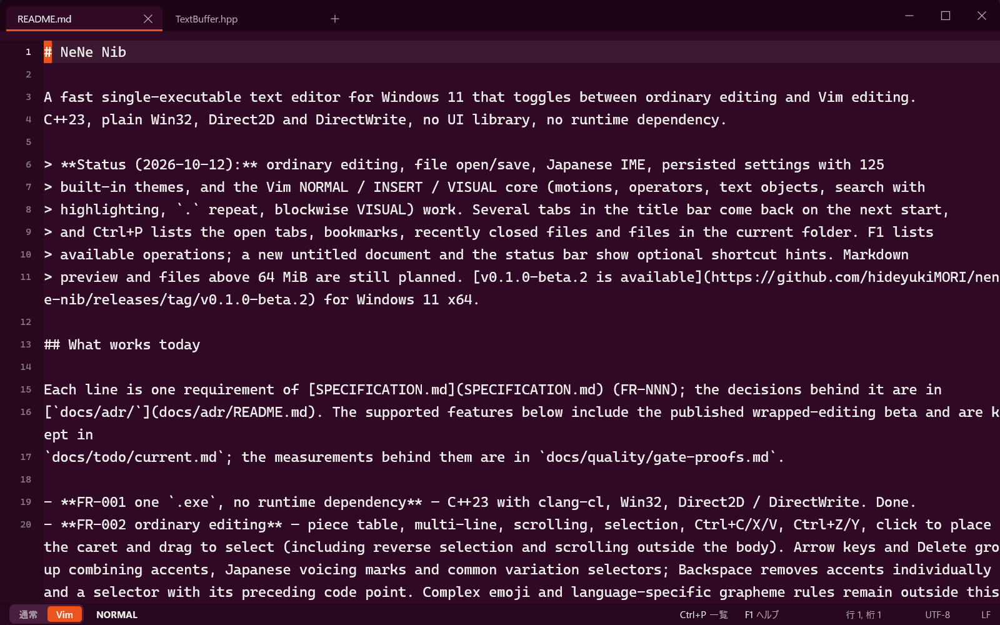
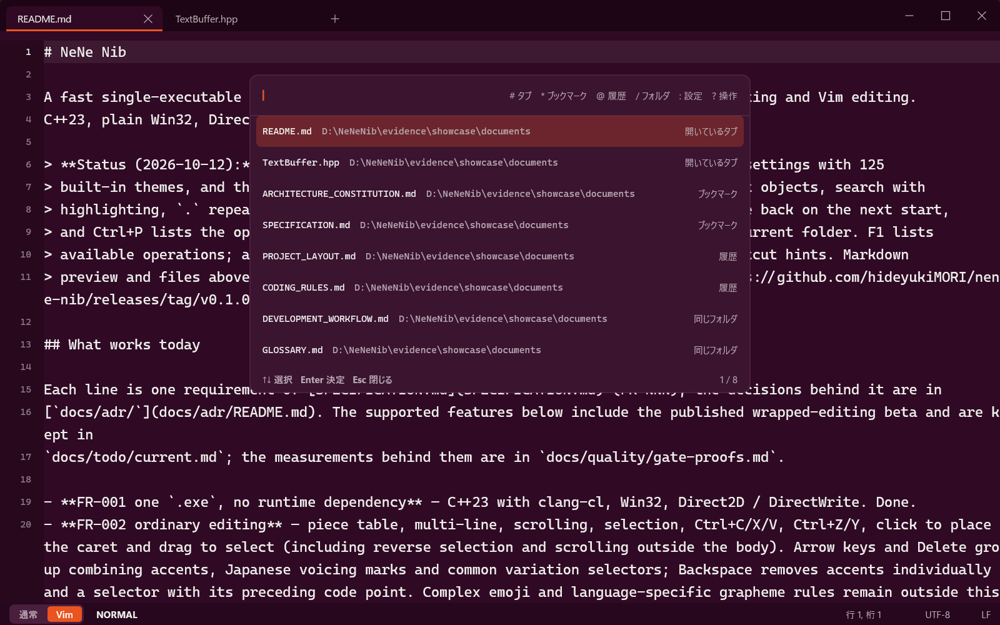
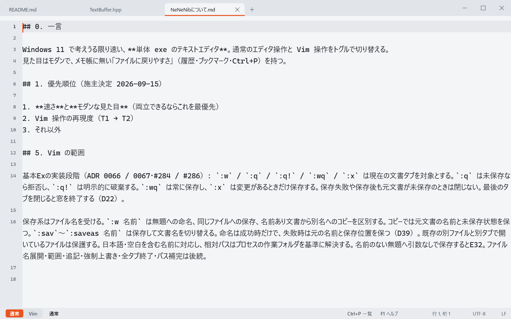
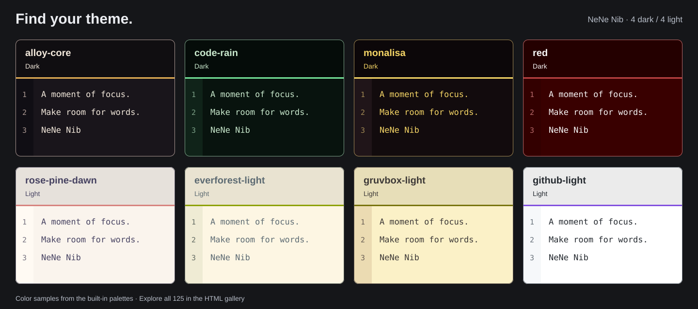

# NeNe Nib

A fast single-executable text editor for Windows 11 that toggles between ordinary editing and Vim editing.



C++23, plain Win32, Direct2D and DirectWrite, no UI library, no runtime dependency.

> **Status (2026-11-14):** [v0.1.0-beta.13](https://github.com/hideyukiMORI/nene-nib/releases/tag/v0.1.0-beta.13)
> (2026-11-14) is the published build for Windows 11 x64. It has ordinary editing with Notepad-style find,
> replace, go to line, printing and date insertion; UTF-8, Shift_JIS and UTF-16 files (UTF-8 up to 1 GiB, read
> in the background); Japanese IME; 125 built-in themes; syntax colors for 25 languages; a Markdown preview with
> clickable task-list checkboxes; a side file explorer; two split panes; opt-in language-server diagnostics; and
> the Vim NORMAL / INSERT / VISUAL core (motions, operators, text objects, search, marks, the jump list, `.`
> repeat, macros, registers, blockwise VISUAL and `map`). Tabs in the title bar come back on the next start,
> Ctrl+P lists open tabs, bookmarks, recently closed files and files in the current folder, and F1 lists every
> operation. It starts in about 45 ms on the owner's machine, autosaves every 30 seconds and offers a grid display
> for giant lines. New in beta.13: the screen text in Japanese, English or Simplified Chinese
> (`:set language=`), an app icon, Vim `:s` with the multis, `\|` and groups in patterns, `gn` `gN` and
> INSERT `Ctrl-o`, and a last resort that backs up unsaved edits before an uncaught exception ends the process.

<p>
  
  
</p>

Screenshots use the default font and size in a development build of 2026-10-12; [capture details](docs/quality/showcase-2026-10-12.md).

## Find your theme



Start with eight favorites: Alloy Core, Code Rain, MonaLisa and Red for dark backgrounds;
Rosé Pine Dawn, Everforest Light, Gruvbox Light and GitHub Light for light backgrounds.

**[Explore the theme gallery](docs/design/colorschemes.html)** — download the HTML and open it in your browser.
Compare all 125 themes, filter by name or appearance, and select a card for a larger color preview.
The image and gallery show color samples, not application screenshots. The gallery works offline and starts
with the plain-text colors; its syntax colors are design samples, not the editor's syntax coloring.
[Theme names and sources](docs/design/2026-10-12-colorschemes.md) are also available as a text list.
All 125 themes are included in the published v0.1.0-beta.13.

## What works today

Each line is one requirement of [SPECIFICATION.md](SPECIFICATION.md) (FR-NNN); the decisions behind it are in
[`docs/adr/`](docs/adr/README.md). Everything below is in the published v0.1.0-beta.13 unless it says
*since beta.13* (on main, not yet published) or *in review* (an open pull request, not on main). The current
tasks are in `docs/todo/current.md`; the measurements are in `docs/quality/gate-proofs.md` and the dated
records in `docs/quality/`.

- **FR-001 one `.exe`, no runtime dependency** — C++23 with clang-cl, Win32, Direct2D / DirectWrite. Done.
- **FR-002 ordinary editing** — piece table, multi-line, scrolling, selection, Ctrl+C/X/V, Ctrl+Z/Y, click to place
  the caret and drag to select (including reverse selection and scrolling outside the body); double-click selects
  a word and triple-click a line (VISUAL in Vim mode). Arrow keys and Delete group combining accents, Japanese
  voicing marks and common variation selectors; Backspace removes accents individually and a selector with its
  preceding code point ([ADR 0065](docs/adr/0065-ordinary-combining-character-boundaries.md)). Ctrl+V pastes HTML
  from the clipboard as Markdown into a Markdown document and as HTML into an HTML document; Ctrl+Shift+V always
  pastes plain text ([ADR 0157](docs/adr/0157-clipboard-html-pastes-by-document-language-through-one-core-converter.md)).
  Ordinary mode follows the Windows standard (decision D82): ↓ on the last screen row goes to the end of the
  text and ↑ on the first screen row to its start. Ctrl+← → stop at word boundaries measured on Notepad, and
  Ctrl+Backspace / Ctrl+Delete remove a word (or the selection). With a selection, an arrow without Shift moves
  from the selection's edge: ← collapses to its start and → to its end. The `:`, search and Ctrl+P lines do not
  yet move or delete by word.
- **FR-003 Vim editing** — NORMAL / INSERT / VISUAL from scratch, replayed against real Vim 9.1: 5951
  oracle-generated fixtures in `tests/vim/fixtures.json` and 402 wrapped-viewport fixtures in
  `tests/vim/wrap-fixtures.json` are checked by CTest, and a differential fuzzer (`eng/vim-fuzz.py`, fixed seeds)
  compares generated key sequences with Vim. Implemented:
  - motions `h j k l 0 $ ^ _ w b e W B E ge gE gg G {N}|`, `f F t T ; ,`, `%` and `{N}%`, `H M L`, Home / End
    (a character includes its combining marks); screen-row motions `gj gk g0 g$ gm gM` and `g_ g^`;
    `{ } ( )`;
  - scrolling Ctrl-d/u/f/b, PgUp / PgDn, `zt zz zb z<CR> z. z- z+ z^`, horizontal `zl zh zL zH zs ze` without
    wrapping; `Ctrl-e` `Ctrl-y`;
  - operators `d c y` + motion, `dd cc yy`, `D C Y`, `x X r`, `J gJ`, `~ g~ gu gU` (including non-ASCII letters),
    `> <` (shiftwidth 8, noexpandtab), `p P`, `Ctrl-a Ctrl-x` and VISUAL `g Ctrl-a`; counts multiply
    (operator × motion);
  - text objects `iw aw iW aW`, quotes, brackets (with the `b` / `B` aliases), `ip ap is as` and `it at`;
  - `i a I A gI o O` with counts, INSERT `Ctrl-w Ctrl-u Ctrl-r {register}`, `gi`, `u` / Ctrl-r, `.` (also in VISUAL);
  - `v V` and blockwise `Ctrl-v` (`o O $`, `d x y r`, `I A c C`, `> <`, `~ u U`, block `p P`, `.`), `gv`; a block
    `p P` whose column falls inside a wide character pads before it instead of splitting it;
    VISUAL `J gJ X D Y` and `C R s I A` as in Vim; VISUAL `p P` (characterwise, linewise and blockwise) replace
    the selection with the register text, and `P` leaves the registers unchanged;
  - registers: unnamed, named `"a`-`"z` / `"A`-`"Z`, numbered `"0`-`"9`, small delete `"-`, black hole `"_`,
    clipboard `"+` `"*` (and `:set clipboard=unnamed`); macros `q @ @@` with counts; a replay by `.` or `@`
    stops after 100,000 keys, drops the rest and says so in one line (decision D75);
  - search `/ ? n N * #` with `hlsearch` and `incsearch` on by default (`:noh`, Ctrl-G / Ctrl-T while typing),
    `gn` `gN` select the last search's match (also after an operator: `cgn` + `.` changes the next one),
    `:set ignorecase` / `smartcase`, and Up / Down history on the `:` and search lines; matchparen highlights
    the partner bracket (on by default); patterns (shared by search and `:s`) take a `magic` subset with `*`
    and the multis on one atom `\+ \= \? \{n} \{n,} \{,m} \{n,m}` and the shortest `\{-n,m}`
    ([ADR 0184](docs/adr/0184-vim-pattern-syntax-grows-in-stages.md) stage 1); `\|`, a multi on a group,
    `\zs` `\ze`, `\v` and patterns across lines come in the next stages;
  - substitute `:[range]s/pat/rep/[g i I n e &] [count]` (ranges `%` `N,M` `.` `$` `'<,'>` `'a,'b` `.,.+N`,
    any non-letter delimiter, `&` `\0`-`\9` with `\( \)` groups, `~` `\r` `\u` `\U` `\l` `\L` `\e`),
    `:&` `:&&` `:~` and NORMAL `&` `g&`, one undo step each
    ([ADR 0168](docs/adr/0168-ex-substitute-family-is-one-edit-with-visible-preview.md)); the `c` flag,
    the typing preview and `:g` `:v` `:sort` are planned;
  - marks `m{a-z}` with `'{a-z}` `` `{a-z} ``, `''`, `'.` and `'^` `` `^ `` (where INSERT was last left)
    ([ADR 0152](docs/adr/0152-vim-marks-are-document-values-adjusted-by-edits.md)), the jump list `Ctrl-o`
    `Ctrl-i` and the change list `g;` `g,` (in Vim mode Ctrl+O is the jump list, so opening a file is Ctrl+Shift+O);
  - `:set relativenumber`, `:set scrolloff=`, virtual columns (Tab = 8, wide = 2), literal CR in LF files,
    Esc everywhere;
  - `:set` takes Vim's short names (`hls is ic scs rnu so ws cb et sw ts`), several arguments in one line
    (`:set ic scs`; a wrong one stops the line and keeps the ones before it), `name?` `noname?` `name&`
    `name<` `name:val` `+=` `-=` `^=`, and `:se` `:setl` `:setg`; `:set nowrapscan` stops searches at the end
    of the text; `magic`, `noexpandtab`, `sw=8` and `ts=8` (the values Nib always has) are accepted and other
    values of them, `number` and `all&` are refused (#1561).

  Basic Ex `:w`, `:q`, `:q!`, `:wq`, `:x` and `:{N}` work on the current tab. `:q` refuses unsaved changes;
  `:wq` always writes, while `:x` writes only changes. These saves accept filenames: `:w name` names an
  untitled document or writes a copy while retaining a named document's unsaved state; `:saveas name`
  changes its name after successful saving. Existing other files are protected unless `:w! name` or
  `:saveas! name` is used. Japanese names, spaces and relative paths (from the process working folder) work;
  filename expansion is planned. Failed writes keep the old name and tab open (D39). See
  [ADR 0067](docs/adr/0067-ex-filenames-share-atomic-save-policy.md).
  Not yet: uppercase marks `'A`-`'Z` and `:marks`, `:g` `:v` `:sort` (FR-027), read-only registers
  `". ": "/ "%`, NORMAL `s S R` and VISUAL `S`, autoindent, dragging into VISUAL with the mouse in Vim mode, easymotion (FR-023),
  commentary, surround and INSERT completion (FR-024).
- **FR-004 one toggle** — the status bar switches "通常 | Vim", and so does `Ctrl+Shift+Space` in either mode (D61). Done.
- **FR-005 tabs in the title bar** — several tabs in the band: click to switch, × and middle click to close, `+` to
  add, a list behind `∨` when they overflow. Ctrl+T, Ctrl+Tab (most recently used order), Ctrl+F4; Vim `gt` `gT`
  and `:tabnext` `:tabprevious` `:tabnew` `:tabclose` `:tabs`. Done; reordering by drag is planned.
  Split panes (decision D64, [ADR 0148](docs/adr/0148-split-keeps-the-active-pane-path-and-parks-the-other.md)):
  Ctrl+\ splits side by side and Ctrl+Shift+\ one above the other, F6 moves to the other pane and Ctrl+Shift+F4
  closes it; Vim uses `Ctrl-w {s v w W p h j k l c q o}` and `:only`. Two equal panes at most; the border cannot
  be dragged and the layout is not restored on the next start.
- **FR-006 Ctrl+P** — opens with an empty input and lists the open tabs, bookmarks, recently closed files and
  files in the current folder, fuzzy-matched by name and then by folder. A leading mark narrows the list:
  `#` tabs, `*` bookmarks, `@` history, `/` the current folder, `:` the settings commands (see below) and
  `?` the operation list. Closed files are kept in a history of up to 100 files; a file that no longer exists
  is reported in one line and dropped from the history. The palette takes Japanese input: it opens with the IME
  off and leaves it to the user after that, and matching walks code points, so a character never matches
  inside the bytes of another. Files in the current folder arrive in the background. Open tabs, bookmarks and
  history entries are not repeated, and hidden, system and known non-text files are excluded. Unknown
  extensions and extensionless names remain available. After 8192 files have been read, a notice stays visible
  until the palette closes. Vim `:e` / `:edit` opens the same all-files palette; `:b` / `:buffer` and
  `:ls` / `:files` / `:buffers` show open tabs. Arguments seed the search (`:b memo` filters tabs); press Enter
  to choose a result. See [ADR 0064](docs/adr/0064-ex-file-commands-open-the-shared-palette.md).
- **FR-007 Markdown preview** — Ctrl+Shift+M shows the rendered Markdown document in the other pane and hides it
  again; the F1 operation "Markdown Preview (Full)" (「Markdown プレビュー（全面）」 in Japanese) or `:preview full` shows it over the whole body, where
  text can be selected and copied but not edited (`:preview side`, `:preview off`). Ctrl+Shift+M
  cycles closed → side pane → full view → closed (D77). Parsing uses md4c 0.5.2 (CommonMark) and the drawing is
  the editor's own ([look](docs/design/2026-10-21-markdown-preview-look.md),
  [ADR 0155](docs/adr/0155-markdown-preview-sits-in-the-other-pane-with-ticketed-port-and-tick.md)).
  Local images (PNG, JPEG, the first frame of a GIF, BMP; D79) are drawn in the text flow,
  shrunk to the pane width but never enlarged; web images and images that cannot be read stay as
  `[画像: alt]`. A retained paragraph is laid out once and redrawn without changing its formatting, so scrolling
  with the preview open does not stall; the first display of a very long paragraph still takes a moment.
- **FR-008 encodings and line endings** — UTF-8, UTF-8 BOM, Shift_JIS and UTF-16 LE / BE with BOM
  ([ADR 0149](docs/adr/0149-utf16-with-bom-is-read-and-written-back.md)); UTF-32 is refused. CRLF / LF are kept as
  read. The encoding and line ending for saving can be chosen by clicking them in the status bar, with
  `:set fenc=` / `:set ff=`, or from F1. Unsaved mark and "save?" prompt; the prompt has its own
  button labels. Unsaved edits are autosaved every 30 seconds and offered back once on the next start after the
  process ends abnormally ([ADR 0137](docs/adr/0137-autosave-every-30-seconds.md)). If an uncaught C++ exception
  is about to end the process on the window thread, Nib backs up the unsaved edits once more and then ends the
  default way, so the next start offers them back (the last resort, #1625). Done.
- **FR-009 tab restore** — starting without a file argument brings back the previous tabs (saved files only): their
  order, the tab in view, caret and scroll position. Only the tab in view is read at startup; the others are read
  when first viewed, and a missing file is dropped with a one-line notice. Done; window position and size are planned.
- **FR-010 bookmarks and jump list** — `Ctrl+D` in ordinary mode and `Ctrl+Shift+D` in Vim mode toggle a
  bookmark for the current named file or the file selected in Ctrl+P. Vim `Ctrl+D` keeps its half-page motion.
  `*` in Ctrl+P shows bookmarks, including open tabs, without duplicate rows. Up to 1024 registrations are
  persisted in `%LOCALAPPDATA%/NeNeNib/bookmarks.v1`; missing files remain registered and can be removed from
  the list. Read/write failures leave the previous list intact and show a one-line notice. The taskbar jump
  list is planned.
- **FR-011 look** — frameless window with an opaque tab band as its title bar, follows the OS light / dark theme (aubergine dark, orange
  accent), one paint per frame. The window corners are square and no Mica backdrop is applied (decision D86); a
  window that is not maximized resizes from all edges and corners, including the top-right corner and a 4 DIP
  strip along the top of × □ ＿, while a maximized window and edges touching the monitor's edge leave those
  pixels to the buttons, so a pointer thrown into the screen corner still hits ×. Done.
- **FR-012 Japanese IME** — IMM32; the composition is drawn in place and committed as one intent; Vim NORMAL turns the
  IME off, INSERT turns it back on. The Ctrl+P palette and the Vim `:` and search lines take a composition: they
  open with the IME off and leave it to the user (D32, D57). The explorer filter also takes Japanese input. Done.
- **FR-013 1 GB files** — UTF-8 files up to 1 GiB are read on the background worker with a one-line "loading"
  notice, so other tabs stay usable; Shift_JIS and UTF-16 open up to 64 MiB
  ([ADR 0159](docs/adr/0159-documents-open-through-one-read-port-that-completes-on-the-worker.md)). Saving and
  whole-document search are still synchronous, and documents above 64 MiB are not autosaved.
  Lines longer than 16,384 characters ask whether to use a grid display (`:set display=grid` / `:set display=text`,
  [ADR 0140](docs/adr/0140-giant-lines-open-as-grid-after-asking.md)).
- **FR-014 Per-Monitor v2 DPI** — declared in the manifest; DIP to pixel conversion is integer-only in the core.
- **FR-015 speed** — targets on the owner's machine (decision D51, 2026-10-16): startup 50 ms, window visible
  40 ms, one keystroke 1 ms, 200 keystrokes 3 ms, open a 16 MiB file 60 ms, 200 keystrokes in 16 MiB 3 ms.
  The gate is separate from the targets: eight Release benchmarks in `eng/measure-speed.py` compare against the
  per-machine references in `eng/perf-reference.json` and fail on regression. The references adopted on
  2026-10-18 ([record](docs/quality/speed-adoption-2026-10-18.md)) are startup 41.9 ms, window visible 32.4 ms,
  one keystroke 0.64 ms, 200 keystrokes 2.16 ms, open 16 MiB 49.8 ms, 200 keystrokes in 16 MiB 2.34 ms, a
  keystroke in a 5000-file palette 1.73 ms and in a long line 1.57 ms. Optional benchmarks run only when
  `--bench <name>` names them: giant lines, 512 MiB / 1 GiB files, the preview, syntax colors, split panes,
  matchparen, and the language server, which is judged apart from the eight (D60). Run on demand and in `-Full`;
  merge CI does not measure.
- **FR-016 colorscheme and syntax colors** — 125 built-in themes plus up to 128 user themes from
  `%LOCALAPPDATA%/NeNeNib/themes/<name>.v1.theme`; `:colorscheme <name>` / `system`, Tab completion, Ctrl+P
  (the focused candidate previews its colors). Done.
  Includes all 28 Vim standard names, VS Code defaults, popular IDE palettes, MonaLisa,
  and 37 original film-inspired palettes. Each has a separate gutter background.
  [Catalog and sources](docs/design/2026-10-12-colorschemes.md) ·
  [Interactive color study](docs/design/colorschemes.html) (open the downloaded HTML locally).
  Syntax colors cover 25 languages chosen by file extension: C, C++, C#, Rust, Go, Python, JavaScript,
  TypeScript, JSON, YAML, TOML, INI, XML, HTML, CSS, Markdown, PHP, SQL, Lua, PowerShell, shell, CMake,
  Dockerfile, GDScript and Godot resources. The language shows at the right of the status bar;
  `:set filetype=` / `:set ft=` changes it and `:syntax on|off` switches coloring for the document
  ([ADR 0156](docs/adr/0156-syntax-colors-are-column-spans-lexed-from-200-lines-above-and-drawn-by-cutting-glyph-runs.md)).
- **FR-017 font size** — `Ctrl` + `+` / `-` / `0`, Ctrl + wheel (8–40 pt), `:set fontsize=` and `:set guifont=`,
  persisted in `%LOCALAPPDATA%/NeNeNib/settings.v4` (v4 adds `ui_language`, `lsp`, `explorer`, `root`, `features` and optional `lsp.<language>.command` lines; limit 16 KiB). The previous v3/v2/v1 files are read only when newer versions are absent and are preserved. Done.
- **FR-018 operation list and hints** — F1 (or `?` in Ctrl+P) lists available operations with their names,
  descriptions and shortcuts; type to filter, then press Enter to run one. Operations without a key in a mode,
  such as find and replace in Vim mode or printing, run from here. An untouched untitled document
  shows three shortcut hints. Otherwise, the status bar shows compact hints when space permits.
  `:set noguide` hides both; `:set guide` restores them. Done.
- **FR-019 wrapping** — on by default. `:set wrap` / `:set nowrap` (also in Ctrl+P settings) changes the display
  without inserting newlines. Ordinary Up/Down, Home/End and pages follow screen rows; Vim `j/k` and `0/$` keep
  logical-line meaning, `gj gk g0 g$` follow screen rows, and H/M/L and page motions use the wrapped viewport.
  Selection, IME composition and hit testing share the body layout. Per-tab wrapped scroll positions are saved
  in `session.v2`; an existing v1 is read and preserved.
- **FR-020 file drop** — drop one or more files from Explorer onto the window to open them in tabs, in either editing mode. Unsaved tabs are kept; a file already open selects its existing tab. A file that cannot be read reports the existing error and the remaining files are still opened. Directories are not opened as documents.
- **FR-021 language server** — off by default (D60). With `lsp=on` and a `lsp.<language>.command=` line in
  `settings.v4`, the editor starts that server (tried with clangd) and shows its diagnostics: wavy underlines, an
  `E2 W1` count at the right of the status bar and the message under the caret. `:set lsp` / `:set nolsp`
  switches it, and untitled documents are not sent
  ([ADR 0160](docs/adr/0160-language-server-io-is-one-port-with-overlapped-pipes-and-a-core-json-rpc-framer.md),
  [ADR 0161](docs/adr/0161-language-server-diagnostics-are-document-values-drawn-as-underlines.md)).
  Completion, hover and go-to-definition are planned.
- **FR-022 file explorer** — Ctrl+Shift+E or `:set explorer` / `:set noexplorer` show a folder tree left of the
  body; `:set root=<path>`, `:set root=.`, Ctrl+Shift+R or F1 choose its root, and both are saved in the settings. Keys, mouse
  and a filter work; a single click opens a file or opens / closes a folder (D80), double-click or Enter also moves the focus to
  the body, and dragging the boundary changes the width, which is remembered (D78)
  ([ADR 0162](docs/adr/0162-file-explorer-is-a-side-panel-fed-by-the-folder-port.md)).
  The panel joins the tab band, uses the UI font and marks files with a dot in their syntax color (D81). A tab
  opened by a single click is a preview tab with an italic title, and the next single click replaces it; editing,
  saving, double-click or Enter keeps it (D83). The root folder dialog also lists installed WSL distributions as
  `\\wsl.localhost\<distro>` places.
- **FR-023 – FR-027 editing features** — matchparen (FR-024) is done and on by default. Planned: easymotion
  (FR-023), commentary, surround, autopairs and INSERT completion (FR-024), changed-line markers, indent guides
  and a yank flash (FR-025), project-wide search (FR-026) and the rest of the `:s` family (FR-027: the `c`
  flag, the typing preview and `:g` `:v` `:sort`; `:s` itself is under FR-003).
- **FR-029 display language** — the screen text is shown in Japanese, English or Simplified Chinese
  (Korean, Spanish and German follow in 1.1.0 and show English until then). The default follows the Windows
  display language; `:set language=ja`, `en`, `zh-hans` or `system` (also from Ctrl+P `:`, or the F1
  operation "Choose Display Language" / 「表示言語を選ぶ」) switches at once and is saved in `settings.v4`;
  `:set language?` shows the choice and what it resolved to. Vim messages, mode names, key names and theme
  names stay as they are. Every screen string comes from one table per language, and string literals with
  Japanese or Chinese text outside those tables fail the conformance check CNF-016
  ([ADR 0123](docs/adr/0123-ui-language-is-a-versioned-setting.md)). The Chinese text is a machine
  translation; corrections are welcome ([docs/i18n/REVIEW.md](docs/i18n/REVIEW.md)).
- **FR-028 / FR-030** — a settings dialog with measured speed costs is planned. A first
  minimap (a retained bitmap at the right edge, `:set minimap`, off by default) shows the document with its
  visible range shaded and edged in the accent color; a click on it scrolls that line to the middle of the
  screen and a drag follows the pointer, without moving the caret
  ([ADR 0171](docs/adr/0171-minimap-is-a-retained-bitmap-redrawn-only-for-edited-lines.md)). A start without
  files or previous tabs shows a start screen on the empty untitled document (decision D70,
  [ADR 0172](docs/adr/0172-start-screen-shows-recent-files-and-entry-actions-on-the-untouched-untitled-document.md)):
  the title, up to 10 recent files and 10 bookmarks as name and folder (read after the first frame, and read
  again in the background whenever the screen appears, so a new untitled tab from Ctrl+T shows them too),
  新しいファイル (with its key Ctrl+T) / ファイルを開く / フォルダを開く (with its key Ctrl+Shift+R, decision D85)
  and the main shortcuts in one column centred horizontally and vertically. ↑ ↓ (and `j` `k` in Vim NORMAL)
  select a row, Enter or a click runs it, and typing or opening a document hides the screen.
- **FR-031 Notepad's operations** — in ordinary mode Ctrl+F finds, F3 / Shift+F3 move to the next or previous
  match, Ctrl+H replaces (Enter one, Ctrl+Enter all) and Ctrl+G goes to a line; Vim mode keeps its own keys and
  reaches the same features from F1 through its `/` and `:` lines
  ([ADR 0174](docs/adr/0174-ordinary-mode-find-replace-and-go-to-line-share-the-input-line-and-the-vim-matcher.md)).
  Printing from F1 or `:hardcopy` draws the body layout
  ([ADR 0177](docs/adr/0177-printing-is-one-port-that-draws-the-body-layout-into-an-xps-print-control.md)).
  F5 inserts the date and time. Ctrl + wheel, the encoding choice and the full Markdown preview are listed
  above. Ordinary mode also takes Ctrl+N (new tab), Ctrl+Insert / Shift+Insert / Shift+Delete (copy / paste /
  cut) and Ctrl+Shift+Z (redo). The right-click menu is planned.
- **FR-032 Vim `map`** — `:map`, `:nmap`, `:imap`, `:vmap`, `:xmap`, `:omap`, the `noremap` and `unmap` forms and
  `:let mapleader=` are stored as `map.<mode>.<lhs>=` and `mapleader` lines in `settings.v4` and applied at the
  window entry, in Vim mode only
  ([ADR 0176](docs/adr/0176-vim-map-is-a-settings-row-applied-by-one-key-table-at-the-window-entry.md)).
- **FR-033 Windows right-click registration** — the F1 operation "Add to Windows Right-Click Menu"
  (「Windows の右クリックに登録する」) adds NeNe Nib to the File Explorer right-click menu and "Open with" under
  `HKCU` without administrator rights; "Remove from Windows Right-Click Menu" (「登録を外す」) removes it. The
  names are written in the display language of the moment you register. Nothing is written at startup. The Windows 11 top-level menu waits for a signed, packaged release
  ([ADR 0178](docs/adr/0178-shell-registration-is-one-port-written-only-by-an-explicit-operation-under-hkcu.md)).
- **FR-034 Markdown task lists** — the preview draws `- [ ]` / `- [x]` checkboxes; clicking one writes the change
  into the text as one undo step, in the side pane and in the full view.

## Using the settings commands

In Vim NORMAL, press `:` and enter `colorscheme` to see the current theme, `colorscheme dracula`
to switch, or `colorscheme system` to follow Windows. `Tab` / `Shift+Tab` cycle completions.
Use `set fontsize=18` or `set guifont=Cascadia Code:h18` for the body font. `Enter` applies;
`Esc` cancels. Left/Right, Home/End, Backspace/Delete and single-line `Ctrl+V` edit the command.
Press `Ctrl+P` in either editing mode and type `:` to choose the same commands from a filtered list,
together with `set wrap` / `nowrap`, `set guide` / `noguide`, `set hlsearch` / `incsearch` and their `no`
forms, `set ignorecase` / `smartcase` / `relativenumber` / `scrolloff=`, `set display=grid|text`,
`set filetype=`, `syntax on|off`, `set clipboard=unnamed`, `set explorer` / `root=`, `set lsp`, `set language=`,
`preview full|side|off`, `hardcopy`, `only` and the tab commands.
Use `set noguide` to hide shortcut hints and `set guide` to show them again (the default).

Settings are saved in `settings.v4`. If it is absent, the editor reads `settings.v3`, then `settings.v2`, then `settings.v1`
only when v2 is also absent; older versions enable wrapping. The first actual settings change writes the new file; the older files are left intact for older
versions. A broken new file is reported and blocks settings writes until repaired and restarted.

The settings file format and failure behavior are specified in
[ADR 0020](docs/adr/0020-versioned-editor-settings-and-point-font-size.md) and the migration in
[ADR 0079](docs/adr/0079-operation-guides-and-settings-migration.md); command behavior is in
[ADR 0022](docs/adr/0022-ex-command-line-and-settings-evaluation.md) and
[ADR 0023](docs/adr/0023-command-palette-and-shared-input-session.md).
Put a [user-theme file](docs/design/user-theme-format.md) in the themes folder, restart, then choose it through
the same `colorscheme` command or Ctrl+P list. Invalid themes report their name and reason; a missing or broken
saved theme leaves the original settings intact and blocks settings writes until repaired and restarted. See
[ADR 0025](docs/adr/0025-user-theme-catalog-and-selection.md).

## What it will be

- One `.exe`, starts instantly, draws with the GPU (Direct2D / DirectWrite, DXGI flip model, DirectComposition).
- Ordinary editing like Notepad, or Vim editing (vanilla Vim defaults first), switched by one key.
  The Vim engine is written from scratch and verified against a real headless Vim.
- Tabs in the title bar, `Ctrl+P` for open files, bookmarks, history and the current folder, a Markdown preview,
  a side file explorer and an optional language server.
- UTF-8 by default with Shift_JIS detection, 1 GB files read on a background worker, Japanese IME from day one.

The requirements are in [SPECIFICATION.md](SPECIFICATION.md) (Japanese).

## How it is built

This repository follows the AYANE strict policy: **one meaning, one canonical implementation path, enforced by machines.**

- `docs/ARCHITECTURE_CONSTITUTION.md` — the rules (ARC-NNN) and how far C++23 / clang-cl reaches for each of them
- `docs/CODING_RULES.md` — the approved subset of C++ (CPP-NNN)
- `docs/QUALITY_GATES.md` — what is enforced right now (active / planned / impossible), the only source of truth
- `docs/quality/phase0-results.json` — the 114 compiler, linker and tool measurements the rules are based on
- `docs/adr/` — decisions: clang-cl over cl, Direct2D over GDI, one UI thread plus one worker, an own Vim engine, a speed gate

Select the smallest checks for the changed behavior and its direct dependencies/callers, and record
the regression rationale and results in the PR. Reuse successful results when the relevant inputs
are unchanged. CI runs only immediately before merging non-document changes through `eng/merge-pr.py`:
a `check` job runs conformance and validates Git conventions and verification records, and a `build-and-test`
job checks formatting, builds every Release target, checks linker symbols and runs CTest. Reviewed pull
requests can be stacked on one integration branch and merged after a single CI run (`merge-pr.py --integration`).
Documentation-only changes skip CI; their PR records a clean `python eng/conformance.py` run.
See `docs/QUALITY_GATES.md`.

For a new Vim fixture group, regenerate just that group with
`python eng/vim-oracle.py --regenerate --only <name-prefix> --reuse-ref <commit>`.
The generator validates the previous inputs, measurement code and Vim environment before reusing
unchanged expectation rows. See [ADR 0026](docs/adr/0026-vim-character-search-and-scoped-oracle.md).
Write one fixture per line; `python eng/vim-oracle.py --format` stores `tests/vim/fixtures.json` in
its one canonical form without running Vim, and CNF-011 refuses any other spelling.

Full verification is opt-in and requires a concrete reason why narrower checks cannot cover the change:

```powershell
pwsh -NoProfile -File ./eng/check.ps1 -Full -Reason 'Concrete scope and reason'
```

It needs Visual Studio Build Tools with the pinned MSVC toolset and the bundled LLVM 19.1.5, CMake, Ninja and
Python 3.12 (`eng/tool-versions.json`). Run `pwsh -NoProfile -File ./eng/bootstrap.ps1` once after cloning.
The Phase 0 measurements can be reproduced with `pwsh -NoProfile -File ./eng/measure-language.ps1`.

## Privacy

NeNe Nib collects and sends no personal information and makes no network connections of its own; see
[PRIVACY.md](PRIVACY.md) (English and Japanese).

## License

MIT. See [LICENSE](LICENSE).
