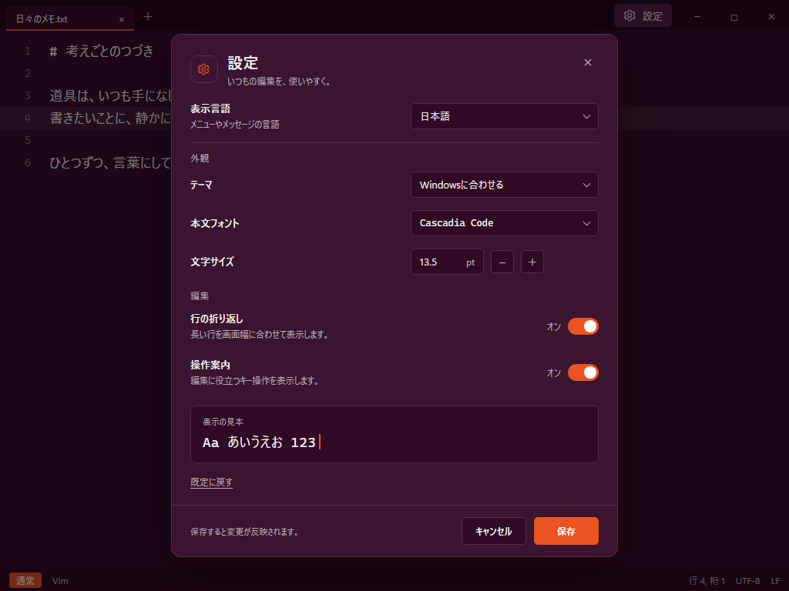
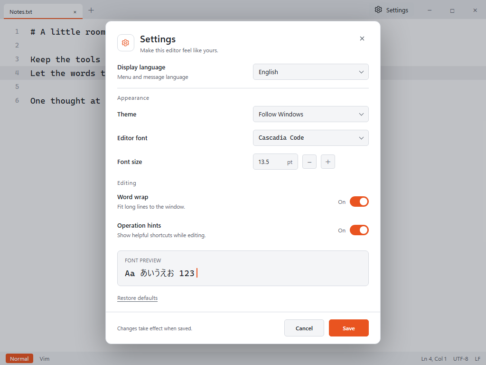
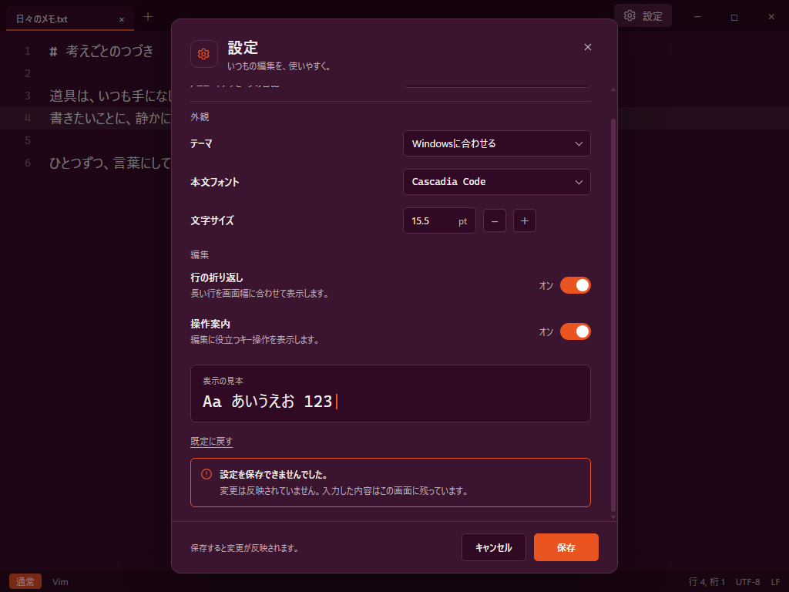
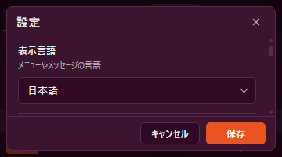
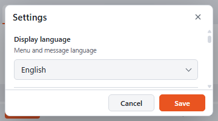
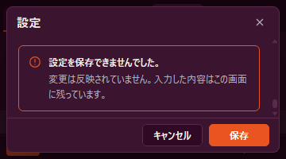

# 設定モーダルの画面案

2026-10-12 / Issue #456 / **提案・hideの選択前・未実装**。

[操作設計案](2026-10-12-settings-dialog-and-language.md)を画面へ起こした。既存の茄子色/ライトと橙のトークン、40 DIPのタブ帯、28 DIPのステータスを基にする。画面の外枠と背後の編集内容は説明用に簡略化したもの。**以下はHTMLから描画した設計資料であり、NeNe Nibの実画面・動作試験・採用済みの画ではない。**

D12の「実装前に画を作りhideが選ぶ」という判断のために保存する。現在の実行環境には過去に使ったClaudeの`/design`がないため、ローカルの画面ソースとPNGで提示する。過去のキャンバスを更新したとは扱わない。今回の資料統合で見た目の採用や実装着手を決定しない。

## 通常幅・日本語

設定名と現在値を横に置き、外観と編集の2群にまとめる。入口はタブ帯の右、窓の最小化ボタンの左。トグルはオン/オフの文字を添える。候補だけを変えて見本で確認し、下の「保存」で一括反映する案。

## 同じ配置の英語・ライト

言語ごとに設定の順序を変えず、ラベルと説明を写す。日本語とEnglishの切替は先頭の選択欄に置く。本文フォントの見本には両言語を残す。英語がライト専用という意味ではなく、言語と配色は独立した設定。

## 保存失敗

文字サイズを13.5→15.5 ptへ変えた候補が残り、見本だけが大きくなっている。背後の本文は変更前のまま。理由はフォーム内に置き、その箇所までスクロールして見せる。「保存」と「キャンセル」は固定する。画像の失敗文は配置用の文案で、実装時には型付きの失敗ごとに原因と次の操作を表示する。

## 最小窓360×200 DIP

| 日本語・先頭の項目 | English・先頭の項目 |
| --- | --- |
|  |  |

見出しと閉じる、保存/取消を残し、項目だけをスクロールする。ラベルの下へ入力欄を移す。最小高さでは副題と見本の常時表示を優先せず、表示中の項目を操作できることを優先する。スクロール位置は言語切替だけでは初期化しない。

失敗時は理由の場所へ移し、候補はスクロールで戻って直せる形。画面読み上げへのエラー通知とフォーカスの移動、項目の見える位置への送りは、静止画だけでは確認できない実装後の対象。

## 寸法・表示の候補

| 部位 | 案 |
| --- | --- |
| 通常の画面資料 | 1024×768、pixel ratio 1。資料上の1pxを1 DIP相当として配置 |
| 通常モーダル | 幅580、通常の高さ680。窓から24以上離し、高さは利用可能範囲で上限を設ける |
| モーダルの文字 | 見出し20、項目13、説明11.5、UIは本文のptに連動しない |
| 本文見本 | 通常13.5 pt＝18 DIP、変更候補15.5 pt＝約20.67 DIP。DPI変換は実装時の既存経路へ接続 |
| 狭い窓 | 周囲8、幅344。見出し15、項目12。最小窓ではheader/項目のscroll/footerに分け、footerは43相当 |
| 保存/取消 | 同じ位置の右下。保存はaccent、取消は背景＋縁。失敗後も利用者が選び直せる |
| 既定に戻す | 項目領域の末尾。保存を押すまで候補だけ変更し、目立つ主操作にはしない |
| エラー | 既存のaccentの縁と記号・文を併用。色だけに意味を持たせない |

これは実装の固定値表ではなく、hideが選ぶ画面案の寸法。実装前に採用案へ整理する。日英、DPI、キーボード、読み上げ、テーマごとの可読性を、この資料の画像だけで合格とはしない。

## ソースと描画記録

唯一の画面ソースは[settings-proposal.html](settings/settings-proposal.html)。外部フォント/CDN/通信や製品コードへの接続はない。`scene`の選択で同じテンプレートから次のPNGを作った。選択欄やトグルは静止画用で、保存や切替を実装した操作プロトタイプではない。

| scene | viewport | 画像 |
| --- | --- | --- |
| ja | 1024×768 | settings-ja.png |
| en | 1024×768 | settings-en.png |
| error | 1024×768 | settings-error.png |
| small | 360×200 | settings-small.png |
| en-small | 360×200 | settings-en-small.png |
| small-error | 360×200 | settings-small-error.png |

Chromeを非表示のheadlessで起動し、DevToolsの表示領域指定で上の寸法へ描画した。profileと補助スクリプトはD側のこの作業専用領域に置いた。最初の狭幅資料にあったgridの最小幅による横切れをソースで修正し、最終の幅は344、左右は8。通常・日英・失敗と狭幅の全画像を目視し、最終画像の保存/取消とエラーが領域に収まることを確認した。これは資料の目視確認であって製品試験ではない。

描画補助と最終の寸法記録は`D:/NeNeNib/evidence/settings-design-456`に収載する。製品のビルド・アプリ/IME/性能試験・CIは実行しない。#446/PR447と#452/PR453は試験保留を維持する。

## 次の判断

- 画面の採用対象: 文字付きの入口、1ページ6項目と見本、保存/取消、最小窓のscroll構成。
- 保存形式とOS言語の解決: [ADR 0123の提案](../adr/0123-ui-language-is-a-versioned-setting.md)。settings.v4は未実装。
- 画面の採用後、候補の状態所有・入力session/IME境界・全翻訳の型を実装ADRで確定する。試験保留中に製品検証済みとして統合しない。

規則: D12、FR-014/016/017/018/019、ARC-001/004/011/012、QLT-001/012/013。Waivers: none。
